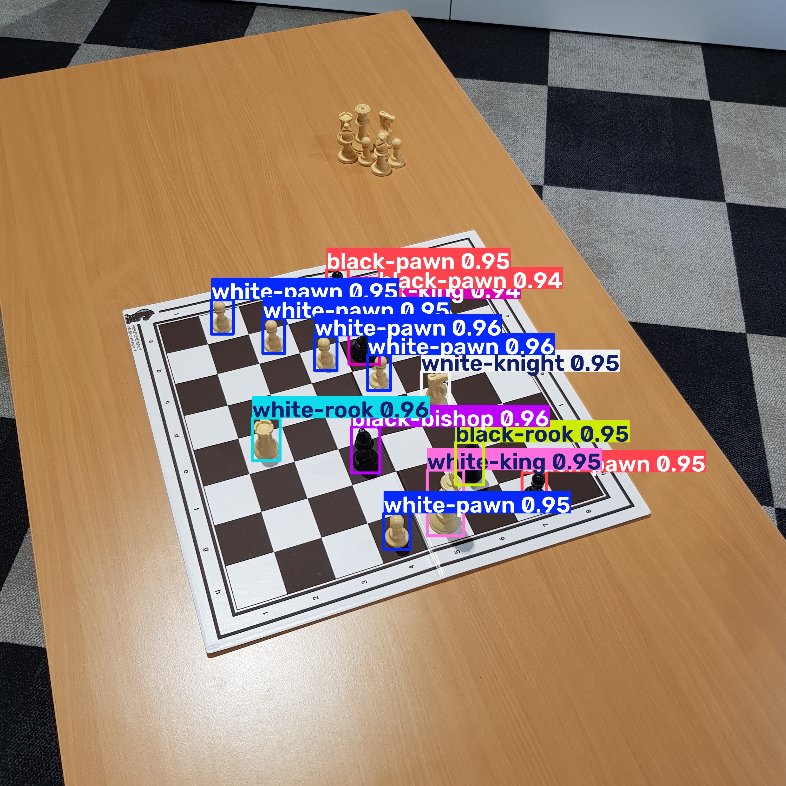

# Registro de desarrollo: asistente inteligente de ajedrez

**Asignatura:** Procesamiento de Imágenes por Computador  
**Proyecto:** Reconocimiento de un tablero físico, cálculo de jugadas con Stockfish y asistencia visual y por voz  
**Sistema operativo:** Ubuntu  

> **Criterio de documentación:** se incluyen los comandos usados durante la preparación y las salidas reales que has compartido. Cuando no has enviado la salida de un comando, se indica expresamente. No se inventan resultados.

## 1. Preparación del proyecto

### 1.1. Instalación de herramientas del sistema

Comando indicado:

```bash
sudo apt update
sudo apt install python3 python3-pip python3-venv git
```

### 1.2. Descarga del repositorio

Comandos indicados:

```bash
git clone https://github.com/alpkirisci/chess_detection_computer_vision.git
cd chess_detection_computer_vision
```

### 1.3. Creación del entorno virtual

Comandos indicados:

```bash
python3 -m venv .venv
source .venv/bin/activate
```

## 2. Instalación de dependencias de Python

Comandos indicados:

```bash
python -m pip install --upgrade pip
python -m pip install ultralytics opencv-python numpy matplotlib pyyaml
```

## 3. Comprobación de los modelos preentrenados

Comando ejecutado:

```bash
ls -lh models/
```

**Salida real:**

```text
total 112M
-rw-rw-r-- 1 natalia natalia 6,0M nov  7 09:36 chess_corner_model.pt
-rw-rw-r-- 1 natalia natalia  50M nov  7 09:36 chess_pieces_model.pt
-rw-rw-r-- 1 natalia natalia 6,0M nov  7 09:36 corner_best.pt
-rw-rw-r-- 1 natalia natalia  50M nov  7 09:36 piece_best.pt
```

**Interpretación:** están disponibles los pesos `corner_best.pt` (detección de esquinas) y `piece_best.pt` (detección de piezas), además de otros dos archivos de modelos. 

## 4. Primera ejecución del detector

Comando ejecutado:

```bash
python chess_inference_example.py
```

**Salida real, inicio y detección de esquinas:**

```text
Creating new Ultralytics Settings v0.0.8 file ✅
View Ultralytics Settings with 'yolo settings' or at '/home/natalia/.config/Ultralytics/settings.json'
Update Settings with 'yolo settings key=value', i.e. 'yolo settings runs_dir=path/to/dir'. For help see https://docs.ultralytics.com/usage/settings
🔍 Chess Detection with Dual Model System
==================================================

image 1/1 /home/natalia/Documentos/UC3M/Asignaturas/Procesamiento de IMG/Trabajo final/ChessGame/chess_detection_computer_vision/chess_board_image.jpg: 640x640 2 top_lefts, 1 top_right, 1 bottom_left, 86.4ms
Speed: 5.1ms preprocess, 86.4ms inference, 3.1ms postprocess per image at shape (1, 3, 640, 640)
✅ Corner model: using 4 corners (reproj err ~ 0.00px)
```

**Salida real, detección de piezas:**

```text
image 1/1 /home/natalia/Documentos/UC3M/Asignaturas/Procesamiento de IMG/Trabajo final/ChessGame/chess_detection_computer_vision/chess_board_image.jpg: 832x832 5 white-pawns, 1 white-rook, 1 white-knight, 1 white-king, 3 black-pawns, 1 black-rook, 1 black-bishop, 1 black-king, 685.6ms
Speed: 3.3ms preprocess, 685.6ms inference, 1.8ms postprocess per image at shape (1, 3, 832, 832)
\nDetection Method: model_detection
Accuracy Level: high
Pieces Detected: 14
```

**Salida real, estado del tablero reconocido:**

```json
{
  "board_state": [
    {"position": "d6", "piece": "white_pawn", "confidence": 0.9601688981056213, "iou": 0.25144887223751367},
    {"position": "b4", "piece": "white_rook", "confidence": 0.9592676162719727, "iou": 0.31071456524295477},
    {"position": "d3", "piece": "black_bishop", "confidence": 0.9571942090988159, "iou": 0.33278739178801625},
    {"position": "e5", "piece": "white_pawn", "confidence": 0.9557639360427856, "iou": 0.2524138853543412},
    {"position": "f4", "piece": "white_knight", "confidence": 0.9540773630142212, "iou": 0.364837746739039},
    {"position": "f2", "piece": "black_rook", "confidence": 0.9538040161132812, "iou": 0.31156065670414496},
    {"position": "d1", "piece": "white_pawn", "confidence": 0.9515189528465271, "iou": 0.2193053370286266},
    {"position": "e1", "piece": "white_king", "confidence": 0.9511099457740784, "iou": 0.5300173558167087},
    {"position": "c7", "piece": "white_pawn", "confidence": 0.9493279457092285, "iou": 0.2555898748653999},
    {"position": "b8", "piece": "white_pawn", "confidence": 0.9489904642105103, "iou": 0.262993075981674},
    {"position": "e8", "piece": "black_pawn", "confidence": 0.9484272003173828, "iou": 0.2855581249769087},
    {"position": "g1", "piece": "black_pawn", "confidence": 0.9474982023239136, "iou": 0.21574281286004446},
    {"position": "f7", "piece": "black_pawn", "confidence": 0.9441943764686584, "iou": 0.2730354778707801},
    {"position": "e6", "piece": "black_king", "confidence": 0.9402931332588196, "iou": 0.6359474778962467}
  ]
}
```

**Salida real, guardado y finalización:**

```text
image 1/1 /home/natalia/Documentos/UC3M/Asignaturas/Procesamiento de IMG/Trabajo final/ChessGame/chess_detection_computer_vision/chess_board_image.jpg: 832x832 5 white-pawns, 1 white-rook, 1 white-knight, 1 white-king, 3 black-pawns, 1 black-rook, 1 black-bishop, 1 black-king, 665.5ms
Speed: 3.7ms preprocess, 665.5ms inference, 1.4ms postprocess per image at shape (1, 3, 832, 832)
Annotated image saved to: annotated_chess_board.jpg
\n✅ Detection completed successfully!
```

### 4.1. Resumen de los resultados

| Pieza reconocida | Cantidad |
|---|---:|
| Peón blanco | 5 |
| Torre blanca | 1 |
| Caballo blanco | 1 |
| Rey blanco | 1 |
| Peón negro | 3 |
| Torre negra | 1 |
| Alfil negro | 1 |
| Rey negro | 1 |
| **Total** | **14** |

Se completó la ejecución y se creó `annotated_chess_board.jpg`. **Todavía no está verificado** que las 14 detecciones y las casillas sean correctas respecto de la imagen original. El texto `Accuracy Level: high` es una salida del programa, no una medida de exactitud calculada frente a anotaciones reales.

## 5. Comprobación visual del reconocimiento de piezas

### 5.1. Visualización de la imagen generada

Después de ejecutar el detector, se ha abierto la imagen anotada para comprobar visualmente los resultados.

**Comando ejecutado:**

```bash
xdg-open annotated_chess_board.jpg
```

**Resultado obtenido:**

Se ha abierto correctamente el archivo `annotated_chess_board.jpg` mediante el visor de imágenes de Ubuntu.



La imagen tiene una resolución de 3024 × 3024 píxeles y contiene las detecciones realizadas por YOLO sobre un tablero de ajedrez físico.

El programa representa las piezas mediante cajas delimitadoras de distintos colores. Cada detección incluye:

- Tipo de pieza.
- Color de la pieza.
- Valor de confianza del modelo.
- Localización mediante una caja delimitadora.

### 5.2. Análisis visual de las detecciones

Se ha comprobado que el sistema ha generado 14 detecciones sobre el tablero.

Las cajas delimitadoras se encuentran situadas sobre las piezas y las etiquetas permiten distinguir los tipos identificados.

**Observaciones:**

1. El modelo identifica piezas blancas y negras.
2. Se reconocen diferentes tipos de piezas, entre ellas peones, torres, un caballo, un alfil y reyes.
3. Los valores de confianza de las detecciones se encuentran aproximadamente entre 0,94 y 0,96.
4. Las piezas aparecen detectadas a pesar de que la fotografía está tomada desde una perspectiva inclinada.
5. Se observan varias piezas fuera del tablero que no aparecen incluidas en las detecciones representadas.
6. Algunas etiquetas se superponen, dificultando la inspección visual de determinadas piezas.

La comprobación visual preliminar muestra que el sistema es capaz de localizar e identificar piezas de ajedrez en la imagen de ejemplo.

Sin embargo, todavía no se ha realizado una validación individual de todas las clases y coordenadas predichas frente a una referencia manual.

### 5.3. Conclusiones de la primera prueba

La ejecución del sistema de reconocimiento ha finalizado correctamente y se ha obtenido una imagen con las detecciones realizadas.

Además, el programa ha generado una estructura de datos que relaciona las piezas reconocidas con las coordenadas de las casillas.

Por tanto, se dispone de una primera implementación funcional sobre la imagen de ejemplo del repositorio.

No obstante, para integrar el sistema con un motor de ajedrez será necesario verificar que las posiciones asignadas a las piezas son correctas.

Un error en la identificación de una pieza o en su casilla podría provocar que el motor analizase una posición diferente de la real.


## 6. Reconstrucción digital del tablero

### 6.1. Instalación de python-chess

Una vez comprobado el funcionamiento inicial del detector YOLO, se ha comenzado a preparar la reconstrucción digital del tablero.

Para ello, se utilizará la biblioteca `python-chess`, que permite representar posiciones de ajedrez, gestionar los movimientos y comprobar su legalidad.

**Comando ejecutado:**

```bash
python -m pip install python-chess
```

**Salida real obtenida (resumen):**

```text
Collecting python-chess
Collecting chess<2,>=1 (from python-chess)
Successfully built chess
Installing collected packages: chess, python-chess
Successfully installed chess-1.11.2 python-chess-1.999
```

La instalación se ha realizado correctamente dentro del entorno virtual `.venv`.

### 6.2. Comprobación de la instalación

Para verificar que Python reconoce la biblioteca, se ha ejecutado:

```bash
python -c "import chess; print('python-chess instalado correctamente')"
```

**Salida real:**

```text
python-chess instalado correctamente
```

**Resultado:**

Se ha comprobado que la biblioteca está correctamente instalada y puede importarse desde Python.

Con ello, el entorno está preparado para comenzar a transformar las detecciones obtenidas mediante YOLO en una representación digital del tablero.

### 6.3. Próximo objetivo

El siguiente paso consistirá en crear un programa que:

1. Reciba las piezas y coordenadas detectadas por YOLO.
2. Construya un tablero digital de 8 × 8.
3. Represente cada pieza en su casilla correspondiente.
4. Genere una representación de la posición utilizando la notación FEN.
5. Permita comparar el tablero reconstruido con la imagen original.

Inicialmente se utilizarán las 14 detecciones obtenidas en la primera prueba.

Posteriormente, se conectará este módulo con la salida del detector para automatizar el proceso.